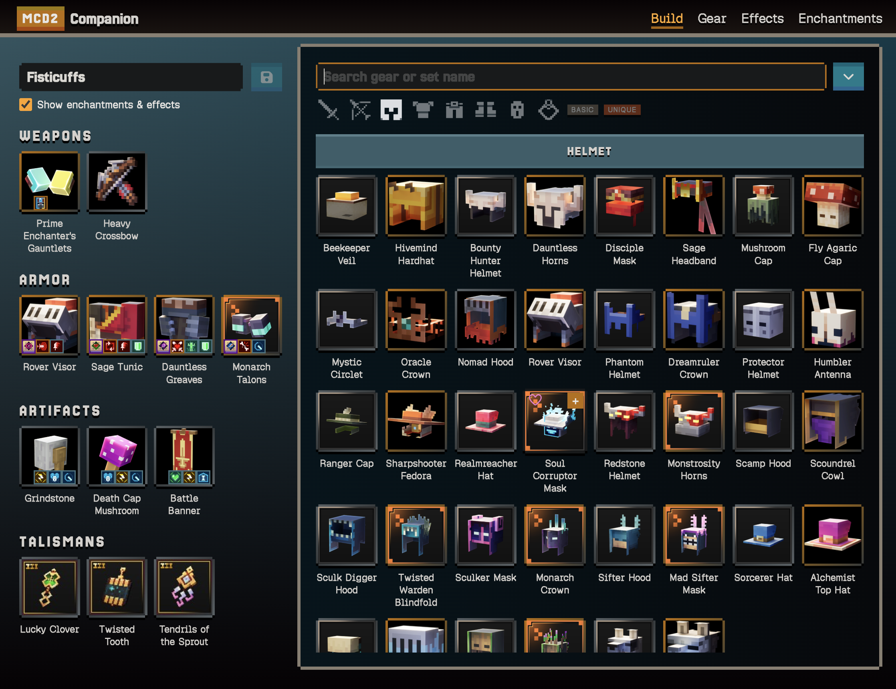

# MCD2 Crawler Companion

A gear build creator for **Minecraft Dungeons II**. Pick an item for each gear slot, choose the enchantment and effects for each piece, then send the link to other people so they can see your build.



## Features

- **Build creator** (`/`): fill the 12 gear slots:
  - Weapons: Melee, Ranged
  - Armor: Helm, Chest, Legs, Boots
  - Artifacts: 3 slots
  - Talismans: 3 slots

  Weapons, armor and artifacts each take one **enchantment** and up to **3 effects** (unique items take 2, because they already come with their own unique effect). Only the enchantments and effects that item can actually roll are offered.
- **Shareable links**: the whole build lives in the URL, so the address bar always holds a link to your current build. Copy it and send it; anyone who opens it sees the same build. Nothing needs to be saved on a server.
- **Saved builds**: give a build a name and save it to keep it in this browser (`localStorage`). Saved builds show up in the saved-builds menu so you can come back to them. They stay on that one browser and device.
- **Catalog pages**: search gear, effects, enchantments, enemies and locations. Gear and effects can be filtered by type, rarity and archetype, and searched by name, set name or description.
- **Favourites**: star catalog items to find them again quickly (also stored in `localStorage`).

### Build URL format

Each slot has a short query parameter that holds the slug of the gear in it:

| Param | Slot | Param | Slot |
| --- | --- | --- | --- |
| `m` | Melee | `r` | Ranged |
| `h` | Helm | `c` | Chest |
| `l` | Legs | `b` | Boots |
| `a1`–`a3` | Artifacts | `t1`–`t3` | Talismans |

Each slot that takes an enchantment and effects adds `<slot>n` for the enchantment and `<slot>e1`–`<slot>e3` for the effects, plus `name` for the build name. For example:

```
/?name=Fire+Axe&m=axe&mn=fire-aspect&me1=acrobat
```

## Tech stack

- [TanStack Start](https://tanstack.com/start) + [TanStack Router](https://tanstack.com/router) (React 19, file-based routes in `src/routes`)
- [Vite](https://vite.dev/), Tailwind CSS, CSS modules and [Web Awesome](https://webawesome.com/) components
- [Supabase](https://supabase.com/) (Postgres + Storage) for the read-only game catalog and thumbnails
- Deployed on [Netlify](https://www.netlify.com/) (`netlify.toml`)

## Running locally

Requires Node 20+.

1. Install dependencies:

   ```bash
   npm install
   ```

2. Create `.env.local` from `.env.example` and fill in your Supabase project values:

   ```
   VITE_SUPABASE_URL=        # Supabase project URL
   VITE_SUPABASE_KEY=        # publishable (anon) key, used by the browser
   SUPABASE_SECRET_KEY=      # server-only, needed only for the sync scripts; never prefix with VITE_
   ```

3. Start the dev server at http://localhost:3000:

   ```bash
   npm run dev
   ```

### Other scripts

```bash
npm run build      # production build (output in dist/client)
npm run preview    # preview the production build
npm run lint       # eslint
npm run format     # prettier + eslint --fix
npm run check      # prettier check
```

## Catalog data

The game data (gear, enchantments, effects, enemies, locations) is stored in Supabase. The schema is in `supabase/migrations`, and the source data is the CSV files in `supabase/seeds`.

- `npm run scrape:<weapons|armor|artifacts|talismans|effects|enchantments>`: pulls data from the [Minecraft Wiki](https://minecraft.wiki/) into the seed CSVs. Wiki content is licensed CC BY-NC-SA 3.0.
- `npm run sync:catalog`: upserts all seed CSVs into Supabase. Each table can also be synced on its own, for example `sync:gear` or `sync:effects`.

The scrape and sync scripts read `.env.local` and need `SUPABASE_SECRET_KEY`.

## Deploying

Netlify builds with `vite build` and publishes `dist/client`. Set `VITE_SUPABASE_URL` and `VITE_SUPABASE_KEY` in the site's environment variables.

---

Fan-made project. Not affiliated with Mojang or Microsoft.
